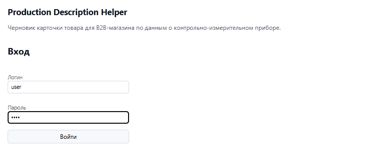
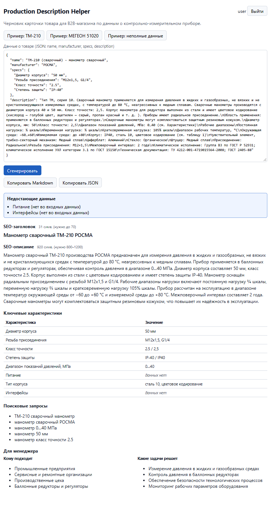
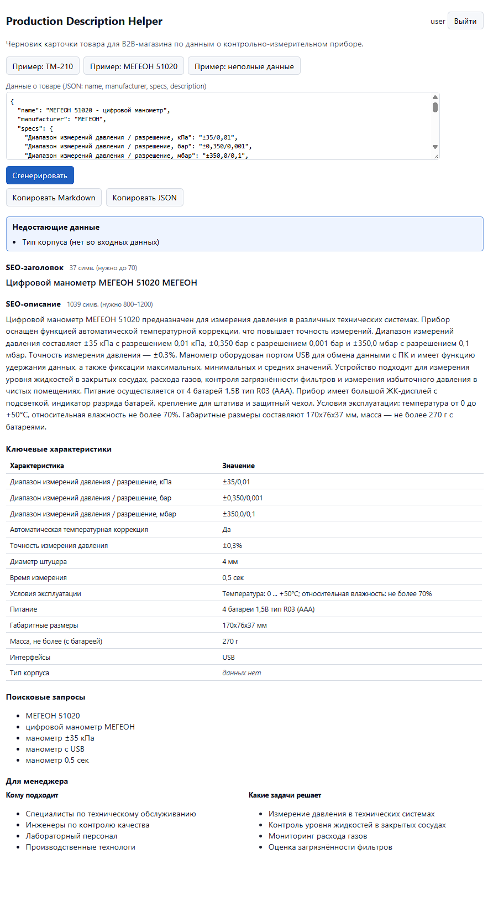
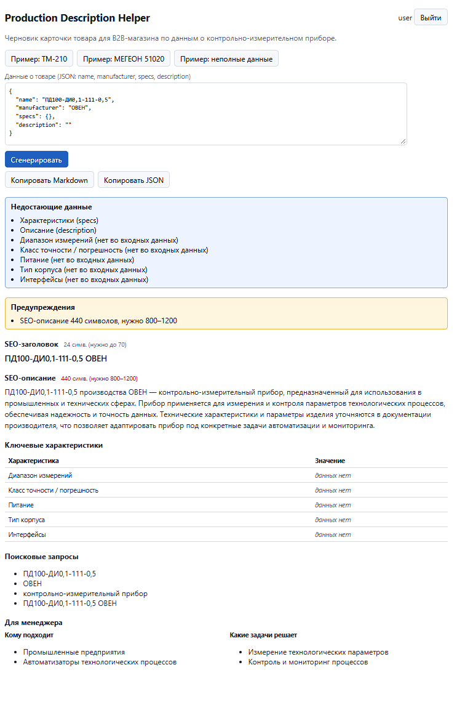
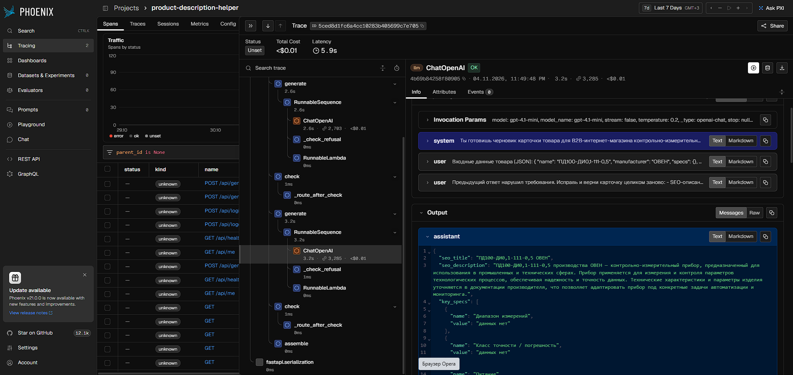

# Production Description Helper

Прототип сервиса, который по JSON с данными о контрольно-измерительном приборе (название, производитель, характеристики, описание) готовит черновик карточки товара для B2B-интернет-магазина. В карточке: SEO-заголовок, SEO-описание, ключевые характеристики, поисковые запросы и блок для менеджера. Главное правило: технические значения берутся только из входных данных. Если характеристики нет во входе, в карточке стоит «данных нет».

```text
браузер ──► frontend (React, nginx) ──/api──► backend (FastAPI + LangChain + LangGraph) ──► OpenAI API
                                                   │
                                                   └── трассы (OpenTelemetry) ──► Phoenix (UI трасс)
```

Три контейнера поднимаются одной командой `docker compose up`.

## Содержание
1. [Требования](#требования)
2. [Установка и запуск](#установка-и-запуск)
3. [Как пользоваться](#как-пользоваться)
4. [Скриншоты](#скриншоты)
5. [Формат входа и выхода, коды ошибок](#формат-входа-и-выхода-коды-ошибок)
6. [Промпт и проверка ответа модели](#промпт-и-проверка-ответа-модели)
7. [Принятые решения](#принятые-решения)
8. [Примеры результата](#примеры-результата)
9. [Соответствие требованиям ТЗ](#соответствие-требованиям-тз)
10. [Ограничения и возможные улучшения](#ограничения-и-возможные-улучшения)
11. [Разработка и тесты](#разработка-и-тесты)

## Требования

- Docker с Compose v2 (`docker compose version`).
- Ключ OpenAI API.
- Для запуска без Docker: Python 3.12 и Node.js 22 (сборщику Vite 8 нужен Node не ниже 20.19).

## Установка и запуск

```bash
git clone https://github.com/chechestor/production_description_helper.git
cd production_description_helper
cp .env.example .env        # затем впишите в .env свой OPENAI_API_KEY
docker compose up --build
```

Других шагов не нужно. Остальные переменные в `.env.example` уже заполнены значениями по умолчанию. Ключ хранится только в `.env`, а `.env` исключён из git (`.gitignore`) и из образов (`.dockerignore`).

| Что | Адрес | Порт задаётся в `.env` |
|---|---|---|
| Веб-интерфейс | http://localhost:3000 | `FRONTEND_PORT` |
| API backend | http://localhost:8000/api/health | `BACKEND_PORT` |
| Phoenix (трассы) | http://localhost:6006 | `PHOENIX_PORT` |

- **Остановить:** `Ctrl+C` в окне `docker compose up` или `docker compose down`. Данные в `data/` при этом сохраняются.
- **В фоне:** `docker compose up -d --build`.
- **Без ключа:** система тоже поднимается. `/api/health` отвечает `"llm_configured": false`, а генерация возвращает понятную ошибку `llm_not_configured`.

### Обновление и перезапуск: `deploy.sh`

```bash
./deploy.sh
```

Скрипт останавливает контейнеры проекта, обновляет исходники (`git pull --ff-only`) и поднимает всё заново (`docker compose up -d --build`). В конце он выводит состояние контейнеров и адреса. На Windows его запускают из Git Bash или WSL.

- **Завершается с кодом 1, ничего не остановив**, если нет `docker compose`, нет `.env` или в отслеживаемых файлах есть незакоммиченные изменения.
- **Если `git pull` не удался** (нет сети, история разошлась), скрипт поднимает прежнюю версию, сообщает, что исходники не обновлены, и тоже выходит с кодом 1.
- **Данные не трогает:** `data/` не удаляется, `docker compose down -v` и `git reset` не используются.

### Запуск без Docker (для разработки)

```bash
python -m venv .venv
.venv/bin/pip install -r backend/requirements.txt -r backend/requirements-dev.txt   # Windows: .venv\Scripts\pip
cd backend && ../.venv/bin/python -m uvicorn app.main:app --port 8000
```

Во втором терминале:

```bash
cd frontend && npm ci && npm run dev    # http://localhost:5173, /api проксируется на localhost:8000
```

Backend читает `.env` из корня проекта; переменные окружения важнее значений из файла. Без Docker в `.env` укажите `PHOENIX_COLLECTOR_ENDPOINT=` (пустое значение отключает трассировку) или `http://localhost:6006`, если Phoenix запущен отдельно.

## Как пользоваться

**Вход.** Логин и пароль задаются в `.env`: `AUTH_LOGIN` и `AUTH_PASSWORD`, по умолчанию `user` / `user`. Значения по умолчанию подходят только для локальной проверки. Чтобы сменить логин или пароль, поправьте `.env` и перезапустите backend: `docker compose up -d backend`. Сессии, выданные под прежним логином, после этого не принимаются. Сессия хранится 7 дней (`SESSION_TTL_HOURS`) и переживает перезапуск контейнеров.

**Веб-интерфейс:**
1. Вставьте JSON товара в поле или нажмите одну из кнопок «Пример: ТМ-210», «Пример: МЕГЕОН 51020», «Пример: неполные данные».
2. Нажмите «Сгенерировать». Ответ приходит за 5–15 секунд.
3. Результат показан по разделам:
   - заголовок и описание со счётчиками символов;
   - таблица характеристик: «данных нет» выделено, значения, которых нет во входе, подсвечены;
   - поисковые запросы и блок «Для менеджера»;
   - отдельные блоки «Недостающие данные» и «Предупреждения».
4. «Копировать Markdown» и «Копировать JSON» кладут результат в буфер обмена.

**API через curl:**

```bash
# вход: cookie сессии сохраняется в cookies.txt
curl -c cookies.txt -H 'Content-Type: application/json' \
     -d '{"login":"user","password":"user"}' http://localhost:8000/api/login

# генерация
curl -b cookies.txt -H 'Content-Type: application/json' \
     --data-binary @examples/input/tm-210.json http://localhost:8000/api/generate
```

Остальные маршруты: `GET /api/health` (без входа), `GET /api/me`, `POST /api/logout`.

**Трассы в Phoenix.** Откройте http://localhost:6006, проект `product-description-helper` (`PHOENIX_PROJECT_NAME`). Один запрос `POST /api/generate` даёт одну трассу `generate_card`. Внутри видны узлы графа `generate`, `check`, `assemble`, повтор, если он был, и вызов модели `ChatOpenAI`: промпт, ответ, модель, токены и время. Запрос, упавший с ошибкой LLM, помечен статусом ERROR. Ключ API в трассы не попадает.

**Папка `data/`.** Монтируется в контейнеры и хранит всё, что должно пережить перезапуск:
- `data/app.db` — SQLite с сессиями входа (пароли в БД не хранятся);
- `data/phoenix/` — данные Phoenix.

Как сбросить данные: остановить систему (`docker compose down`) и удалить `data/app.db` и/или `data/phoenix/`. При следующем старте база создастся заново. Файл `data/.gitkeep` оставьте.

## Скриншоты

### Экран входа

Форма входа по логину и паролю из `.env`.



### Генерация для ТМ-210

Вход из [`examples/input/tm-210.json`](examples/input/tm-210.json) и карточка: «Питание» и «Интерфейсы» — «данных нет».



### Генерация для МЕГЕОН 51020

Вход из [`examples/input/megeon-51020.json`](examples/input/megeon-51020.json) и карточка: интерфейс USB взят из описания, «Тип корпуса» — «данных нет».



### Генерация при недостаточных данных

Вход только с названием и производителем ([`examples/input/incomplete-pd100.json`](examples/input/incomplete-pd100.json)): недостающие данные, «данных нет» и предупреждение о длине описания.



### Трасса генерации в Phoenix

Трасса запроса для неполного входа: повтор `generate → check` после нарушения, затем `assemble`. Справа вызов `ChatOpenAI` с параметрами модели, промптом, ответом, токенами и стоимостью.



## Формат входа и выхода, коды ошибок

**Вход** — тело `POST /api/generate`:

```json
{
  "name": "Манометр показывающий DM 02",
  "manufacturer": "Манотомь",
  "specs": {"диапазон измерений": "0–1,6 МПа", "класс точности": "1,5"},
  "description": "Прибор предназначен для измерения избыточного давления..."
}
```

- Обязательно только `name`. Пустые `manufacturer`, `specs`, `description` не мешают генерации и попадают в `missing_fields`.
- Значения `specs` — строки или числа (числа приводятся к строке как есть). `null` и `""` считаются отсутствующими.
- Лишние поля игнорируются с предупреждением в `warnings`.
- Значения не исправляются: единицы, запятые и регистр остаются как во входе.

**Выход** (200):

```text
{
  "card": {
    "seo_title": str,                                        // ≤ 70 символов
    "seo_description": str,                                  // 800–1200 символов
    "key_specs": [{"name": str, "value": str, "verified": bool}],   // verified — значение найдено во входе
    "search_queries": [str],                                 // 3–5
    "commercial": {"audience": [str], "tasks": [str]}
  },
  "missing_fields": [str],   // например «Описание (description)», «Питание (нет во входных данных)»
  "warnings": [str],         // противоречия во входе и нарушения, оставшиеся после повтора
  "markdown": str            // та же карточка в Markdown, собирается кодом
}
```

**Ошибки** приходят в едином формате `{"error": {"code", "message", "details"}}`, `message` — на русском, без трейсбека.

| HTTP | `code` | Когда |
|---|---|---|
| 401 | `unauthorized` | Нет действующей сессии (проверяется раньше JSON) |
| 401 | `invalid_credentials` | Неверный логин или пароль (одинаково для обоих) |
| 503 | `auth_not_configured` | В `.env` пусты `AUTH_LOGIN` или `AUTH_PASSWORD` |
| 400 | `invalid_json` | Тело не JSON; в `message` строка и столбец ошибки |
| 422 | `invalid_input` | JSON не объект |
| 422 | `missing_name` | `name` нет, пустой или из пробелов |
| 422 | `invalid_field` | Неверный тип поля; `details.field` — имя поля, например `specs.Класс` |
| 422 | `too_large` | `description` > 20 000 символов или в `specs` > 100 пунктов |
| 503 | `llm_not_configured` | Не задан `OPENAI_API_KEY` |
| 502 | `llm_auth_error` | OpenAI отклонил ключ (401/403) |
| 503 | `llm_rate_limited` | Лимит запросов или перегрузка OpenAI (429, 503) |
| 504 | `llm_timeout` | Модель не ответила за `LLM_TIMEOUT` секунд |
| 502 | `llm_unavailable` | Сеть, 5xx OpenAI, прочие ошибки API |
| 502 | `llm_bad_response` | Ответ модели не по схеме и после повтора |

Ошибка LLM пишется в лог контейнера одной строкой: код и тип исключения, без ключа, промпта и входных данных.

## Промпт и проверка ответа модели

Промпт лежит в [`backend/app/generation/prompt.py`](backend/app/generation/prompt.py) (`SYSTEM_PROMPT`). Модель отвечает строго по JSON-схеме (structured output, [`schema.py`](backend/app/generation/schema.py)).

**Ключевые правила промпта:**
1. **Дословность.** Технические значения — числа, единицы, диапазоны, классы, резьбы, интерфейсы, питание — берутся только из `specs` и `description` и переносятся дословно. Единицы не пересчитываются. Если единица стоит в названии характеристики, она там и остаётся.
2. **Базовые характеристики.** Диапазон измерений, класс точности / погрешность, питание, тип корпуса и интерфейсы обязательны в `key_specs`. Если их нет во входе, они идут со значением «данных нет» и попадают в `missing_fields`. Модель ищет их и под другими названиями («Диапазон показаний») и не дублирует.
3. **Противоречия.** Если во входе для одного параметра указаны несовместимые значения, модель не выбирает одно, а записывает оба через « / ». Код добавляет предупреждение «противоречие в данных». Одно значение в разном написании («2.5» и «2,5») противоречием не считается.
4. **Тексты.** SEO-тексты без превосходных степеней, цены, гарантий и сроков, которых нет во входе. Если данных мало, текст короче, но без выдумки.

**Проверка кодом** (узел `check`, [`checks.py`](backend/app/generation/checks.py)):
- a) заголовок не длиннее 70 символов;
- b) описание от 800 до 1200 символов;
- c) 3–5 непустых поисковых запросов;
- d) каждое значение `key_specs` (кроме «данных нет») найдено во входе. Сравнение без учёта регистра и лишних пробелов; `×`/`х`/`x`, похожие кириллические и латинские буквы, `,` и `.` в дробях считаются одинаковыми. Значение «A / B» проверяется по частям;
- e) каждое число из SEO-описания встречается во входе как отдельное число.

Если хотя бы одна проверка не прошла, граф один раз возвращается к модели: в запрос добавляются список нарушений и предыдущий ответ. Что осталось после повтора, уходит в `warnings` (например «SEO-описание 668 символов, нужно 800–1200»), а не найденные во входе значения получают `verified: false`. Текст модели код не обрезает и не дописывает.

## Принятые решения

- **LLM — OpenAI, модель `gpt-4.1-mini`** (`LLM_MODEL` в `.env`). Она дешёвая, быстрая и поддерживает structured output по JSON-схеме: ответ либо разбирается в схему, либо идёт в повтор. Температура 0.2, таймаут `LLM_TIMEOUT`. На примерах генерация занимает 5–15 секунд.
- **LangChain и LangGraph.** Генерация — граф `generate → check → (один повтор generate) → assemble`. Цикл «ответ модели → проверка кодом → повтор с нарушениями» явно виден в коде и в трассах; повторов не больше одного, состояние явное. Многоагентности, инструментов и памяти нет: для задачи это лишнее.
- **Phoenix.** Трассы LangChain/LangGraph уходят через OpenTelemetry (OpenInference): видно, какой промпт ушёл, что ответила модель, сколько токенов, где сработал повтор. Если Phoenix недоступен, генерация работает как обычно.
- **Markdown собирает код, а не модель.** Он гарантированно совпадает с JSON-карточкой, модель не может добавить в него ничего лишнего, а пометки о недостающих данных и предупреждениях всегда на месте.
- **Данные со страниц, а не из фида.** В YML-фиде магазина у товаров есть только название, производитель, цена и ссылка, характеристик и описаний нет. Поэтому для двух примеров `specs` и `description` скопированы дословно со страниц товаров. Неполный пример собран только из фида и показывает отчёт о недостающих данных. Подробнее — [`examples/README.md`](examples/README.md).
- **Вход по логину и паролю из `.env`** и сессии в SQLite в `data/`. Пользователь один, пароль сравнивается за постоянное время и нигде не хранится.
- **CI на GitHub Actions** ([`.github/workflows/ci.yml`](.github/workflows/ci.yml)). На каждый push и PR в `main` запускаются тесты без LLM (`pytest -m "not llm"`) и сборка образов (`docker compose config`, `docker compose build`, наличие образа Phoenix с зафиксированным тегом). Деплоя, публикации образов и секретов в CI нет.

## Примеры результата

Для двух товаров и одного неполного входа:
- входы — [`examples/input/`](examples/input/);
- ответы API — [`examples/output/`](examples/output/): `*.json` целиком и `*.md` (поле `markdown`);
- источники и пояснения — [`examples/README.md`](examples/README.md).

Получены реальным вызовом `gpt-4.1-mini`. У неполного примера осталось предупреждение о длине описания: из одного названия 800 символов без выдумки не написать, и это видно в ответе.

## Соответствие требованиям ТЗ

| # | Требование ТЗ | Статус | Примечания |
|---|---|---|---|
| 1 | Прототип: по данным прибора — черновик карточки для B2B (п.1) | Выполнено | `POST /api/generate` и веб-интерфейс |
| 2 | Данные двух товаров: название, производитель, характеристики, описание (п.2) | Выполнено | [`examples/input/`](examples/input/): ТМ-210 и МЕГЕОН 51020, плюс неполный вход. В фиде характеристик и описаний нет, поэтому `specs` и `description` взяты дословно со страниц товаров |
| 3 | Вход — JSON или простая веб-форма (п.3.1) | Выполнено | API и поле JSON в веб-интерфейсе с кнопками примеров |
| 4 | Передача данных в LLM через API (п.3.2) | Выполнено | OpenAI `gpt-4.1-mini` через LangChain и LangGraph |
| 5 | Формирование черновика карточки (п.3.3) | Выполнено | Граф generate → check → повтор → assemble |
| 6 | Результат, удобный для копирования (п.3.4) | Выполнено | JSON и Markdown, кнопки «Копировать Markdown» и «Копировать JSON» в интерфейсе |
| 7 | Сообщать, каких полей не хватает (п.3.5) | Выполнено | `missing_fields`, в интерфейсе блок «Недостающие данные» |
| 8 | SEO-заголовок до 70 символов (п.4) | Выполнено | В примерах 31, 37 и 24 символа; длину проверяет код |
| 9 | SEO-описание 800–1200 символов (п.4) | Выполнено, с оговоркой | ТМ-210 — 1080, МЕГЕОН 51020 — 881. У неполного входа 668 символов и предупреждение в ответе: из одного названия 800 символов без выдумки не написать |
| 10 | Структурированный список ключевых характеристик (п.4) | Выполнено | `key_specs`: название, значение, признак `verified` (значение найдено во входе) |
| 11 | 3–5 поисковых запросов (п.4) | Выполнено | В примерах 5, 5 и 4; количество проверяет код |
| 12 | Commercial-блок: кому подходит и какие задачи решает (п.4) | Выполнено | `commercial.audience` и `commercial.tasks`, раздел «Для менеджера» |
| 13 | Python или JavaScript/TypeScript (п.5) | Выполнено | Backend на Python (FastAPI), интерфейс на React |
| 14 | API одной LLM (п.5) | Выполнено | Только OpenAI |
| 15 | API-ключ не в коде (п.5) | Выполнено | Ключ только в `.env`, который исключён из git (`.gitignore`) и из образов (`.dockerignore`) |
| 16 | Обработка ошибок API, пустых полей, некорректного JSON (п.5) | Выполнено | Единый формат ошибок, 14 кодов (таблица выше); тесты `test_validation.py` и `test_llm_errors.py` |
| 17 | Не выдумывать характеристики (п.5, п.8) | Выполнено | Промпт требует дословного переноса; код сверяет значения и числа со входом и при нарушении делает один повтор. Ограничения проверки — в следующем разделе |
| 18 | «Данных нет» для отсутствующих характеристик (п.5) | Выполнено | Например, у ТМ-210 «Питание» и «Интерфейсы»; у неполного входа — все пять базовых характеристик |
| 19 | Ссылка на Git-репозиторий (п.6) | Выполнено | — |
| 20 | README с инструкцией по установке и запуску (п.6) | Выполнено | Docker, запуск без Docker, `deploy.sh` |
| 21 | Пример результата для двух товаров (п.6) | Выполнено | [`examples/output/`](examples/output/) |
| 22 | Описание промптов и принятых решений (п.6) | Выполнено | Разделы «Промпт и проверка ответа модели» и «Принятые решения» |
| 23 | Ограничения и возможные улучшения (п.6) | Выполнено | Раздел «Ограничения и возможные улучшения» |
| 24 | Не нужны CMS, админ-панель, БД, деплой; достаточно MVP (п.8) | Сделано шире | Добавлены вход по логину и паролю, SQLite для сессий входа, трассы в Phoenix, CI на GitHub Actions, `deploy.sh` для перезапуска на сервере. CMS и админ-панели нет |

## Ограничения и возможные улучшения

- **Проверка эвристическая.** Сверка значений и чисел строковая: она ловит выдуманные числа и значения, но не понимает смысл. Например, она не отличит верное число, перенесённое не к той характеристике.
- **Смысловую выдумку без чисел код не ловит** («подходит для агрессивных сред», если этого нет во входе). Улучшение — вторая проверка моделью-«судьёй» по входу или правила на ключевые слова.
- **Мало данных — бедное описание.** При одном `name` описание получается коротким и общим, длина 800–1200 не выполняется, о чём сервис честно предупреждает.
- **Фид без характеристик.** Сейчас входы собраны вручную со страниц. Улучшение — загрузка товара по ссылке или офферу с разбором страницы.
- **Нет пакетной обработки.** Один запрос — один товар. Улучшение — загрузка фида или CSV с очередью и отчётом.
- **Генерация одноразовая.** Каждый запрос независим, контекст не хранится. Направление развития — работа по отдельным сессиям с агентом, который формирует описание: дополнительные требования и запросы на корректировку уже сгенерированной карточки с сохранением контекста. В рамках тестового задания не проработано.
- **Модель иногда нарушает правила текста.** Например, повторяет производителя в заголовке. Код текст модели не правит, поэтому такие огрехи видны в результате.
- **Оценки качества на наборе товаров нет.** Улучшение — датасет и эксперименты в Phoenix для сравнения промптов и моделей.
- **Вход упрощён.** Один пользователь из `.env`, без HTTPS. Это прототип для локального запуска.

## Разработка и тесты

```bash
cd backend
../.venv/bin/python -m pytest              # все быстрые тесты: без сети, ключа, Phoenix и Docker; LLM замокана
../.venv/bin/python -m pytest -m "not llm" # то же, что в CI
../.venv/bin/python -m pytest --inputs=feed tests/test_inputs.py   # входы из живого YML-фида (нужна сеть)
```

Тесты покрывают проверку входа, проверки ответа модели и повтор, ошибки OpenAI API. Тестовые входы задаются опциями `--inputs=local|feed`, `--inputs-dir`, `--feed-url`, `--offer-ids`.

```text
backend/app/            FastAPI: main.py, auth.py (вход), validation.py (проверка входа), errors.py, tracing.py
backend/app/generation/ prompt.py, schema.py, graph.py (LangGraph), checks.py, llm.py, markdown.py
backend/tests/          pytest
frontend/src/           React: вход и основной экран
examples/               входы и результаты
data/                   данные, переживающие перезапуск (в git только .gitkeep)
.claude/                служебные файлы команды AI-агентов, которая вела разработку (бэклог, решения)
```
